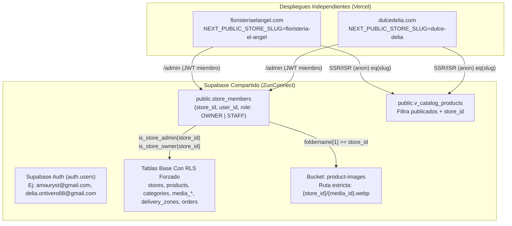

# Plan de Migración: Dulce Delia ("Donde Delia") a Tenant de ZunConnect

> **Objetivo:** Convertir el catálogo estático actual de **Dulce Delia** (`Vite + React SPA` con `public/data/products.json`) en un nuevo tenant de producción dentro de la plataforma multi-tenant **ZunConnect** (en la misma instancia de Supabase que **Floristería El Ángel**), incorporando lectura dinámica del catálogo, modo vista previa de borradores y consola de administración `/admin` independiente por tienda.

---

## 1. Diagnóstico del Estado Actual vs. Arquitectura Destino (ZunConnect)

| Dimensión | Estado Actual (`dulce-delia`) | Arquitectura Destino (Estándar ZunConnect / `floristeria-elangel`) |
|---|---|---|
| **Framework** | Vite 5 + React 18 SPA (`index.html`, `src/App.tsx`) | **Next.js 16 (App Router)** + React 19 + TypeScript estricto + Tailwind CSS |
| **Fuente del Catálogo** | Archivo estático `/public/data/products.json` (20 pasteles, sin precios en JSON) | Vista pública **`public.v_catalog_products`** en Supabase con ISR (`revalidate = 60`) |
| **Imágenes** | Archivos locales en `/public/assets/galeria/*.webp` | Bucket público **`product-images/{store_id}/{uuid}.webp`** + arquitectura **`media_by_slot`** (`PRODUCT_PRIMARY`, `PRODUCT_GALLERY`, `PRODUCT_PRESENTATION`, etc.) |
| **Placeholders** | `animate-pulse bg-arena-clara` | prohibido base64/blur en BD; componente `SlotImage.tsx` con `/placeholders/default-cake.svg` local + skeleton Tailwind |
| **Precios** | No definidos por producto en `products.json` | Enteros en centavos (`price_cents`, `price_delta_cents`) formateados en UI como `(cents / 100).toFixed(2)` |
| **Checkout / Pedidos** | Formulario React Hook Form + Zod (`EmailContactForm.tsx`) que abre `wa.me/5358383378` o `mailto:` | Configuración por tenant en `public.stores`: `save_orders = false`, `show_delivery_zone = false`, `payment_methods = '{WHATSAPP_COORDINATION}'` + rutas puente `/pedir/...` para analítica sin cookies |
| **Administración** | Inexistente (edición manual de código/JSON) | Consola **`/admin`** propia del deployment (Catálogo, Pendientes de aprobación, Medios/Slots, Zonas, Pedidos) con Supabase Auth (Google OAuth + Email/Password) |

---

## 2. Arquitectura de Aislamiento Multi-Tenant y Seguridad

Para garantizar que **jamás se mezclen datos entre tiendas** y que un mismo usuario (ej. `amauryst@gmail.com`) pueda administrar varios tenants entrando a la consola `/admin` de cada tienda sin existir una consola unificada:



### Garantías de Seguridad (Estándar Floristería El Ángel)

1. **Aislamiento de Tenant por Variables de Entorno y Servidor (`server-only`):**
   - Cada deployment define su propio `NEXT_PUBLIC_STORE_SLUG="dulce-delia"`.
   - En tienda pública (`src/lib/catalog/queries.ts`), `getActiveStore()` resuelve el `store.id` filtrando por `slug = NEXT_PUBLIC_STORE_SLUG` y `is_active = true`, seleccionando únicamente columnas públicas explícitas (`STORE_PUBLIC_COLUMNS`). Todas las consultas posteriores (`v_catalog_products`, `categories`, `delivery_zones`) llevan `.eq("store_id", store.id)`.
   - En consola `/admin` (`src/lib/admin/session.ts`), `getAdminAccess()` valida el JWT contra el servidor de Auth con `supabase.auth.getUser()` (nunca `getSession()`) y comprueba que exista fila en `public.store_members` para `(store.id, user.id)`.
2. **Mismo Usuario en Múltiples Tenants (Sin Consola Unificada):**
   - La tabla `public.store_members` relaciona `(store_id, user_id, role)`.
   - `amauryst@gmail.com` tiene fila `OWNER` con el `store_id` de `floristeria-el-angel` y tendrá otra fila `OWNER` con el `store_id` de `dulce-delia`.
   - Si el dueño de la floristería (`elangelenflor@gmail.com`) intenta entrar a `dulcedelia.com/admin`, aunque su sesión de Supabase Auth sea válida, `getAdminAccess()` consulta `store_members` para `store_id = <id_dulce_delia>` y devuelve `{ status: "denied", reason: "Esta cuenta no es miembro de la tienda." }`.
   - Además, como cada tienda vive en su propio dominio, las cookies `@supabase/ssr` de sesión están aisladas por dominio en el navegador.
3. **Defensa en Profundidad en Base de Datos (RLS, Grants y Triggers):**
   - **Rol `anon`:** Sin permisos (`REVOKE ALL`) sobre tablas internas (`products`, `media_placements`, `media_assets`, `product_categories`, `orders`, `store_members`) ni sobre `v_catalog_products_staging`. Solo `SELECT` en `v_catalog_products`, `stores`, `categories`, `delivery_zones`, `media_slots`.
   - **Políticas RLS por `store_id`:** Todas las tablas de administración exigen `is_store_admin(store_id)` para lectura/escritura de miembros y `is_store_owner(id)` para actualizar `stores`. Ningún Server Action usa `SUPABASE_SERVICE_ROLE_KEY`; todo corre con el cliente de sesión del usuario autenticado para que Postgres aplique RLS.
   - **Aislamiento en Supabase Storage (`product-images`):**
     - La política `"Admin list product images"` exige `bucket_id = 'product-images' AND is_store_admin(((storage.foldername(name))[1])::uuid)`.
     - El trigger `aa_guard_approval` (`guard_media_asset`) bloquea cualquier `INSERT` en `media_assets` cuya ruta no coincida exactamente con `{store_id}/{id}.webp`. Un miembro de otra tienda no puede listar, subir ni vincular imágenes fuera de la carpeta UUID de su `store_id`.
   - **Flujo Staging → Aprobación (`aa_guard_approval`):**
     - Los triggers `guard_product_approval`, `guard_placement_approval` y `guard_media_asset` impiden que un rol `STAFF` publique directamente o modifique productos en vivo (`is_live = true`), forzando el paso por `draft_data` y `PENDING_APPROVAL` hasta que un `OWNER` ejecute la RPC `approve_and_publish_product`.
   - **Protección Legal / Zero-PII (`reject_orders_when_disabled`):**
     - Configurando `save_orders = false` en la fila de `stores` para `dulce-delia`, el trigger `orders_reject_when_disabled` bloquea en base de datos cualquier intento de insertar pedidos en `public.orders` (incluso si alguien invoca la RPC `create_checkout_order` directamente con la `anon` key).

---

## 3. Fases de Implementación

### Fase 1: Aprovisionamiento del Nuevo Tenant en Supabase (SQL)

Ejecutar una migración SQL idempotente en el SQL Editor de Supabase (`supabase/migrations/20261104000000_create_tenant_dulce_delia.sql`) que:

1. **Cree el registro en `public.stores`:**
   - `slug`: `'dulce-delia'`
   - `name`: `'Donde Delia'`
   - `country_code`: `'CU'`
   - `currency`: `'USD'`
   - `whatsapp_number`: `'5358383378'`
   - `enable_whatsapp_checkout`: `true`
   - `is_active`: `true`
   - `save_orders`: `false` (pedidos directos a WhatsApp sin almacenar datos personales en BD, igual que El Ángel)
   - `show_delivery_zone`: `false`
   - `payment_methods`: `'{WHATSAPP_COORDINATION}'`
2. **Cree las categorías iniciales en `public.categories` para `dulce-delia`:**
   - Mapear las 4 categorías actuales de `src/config/bakeryOptions.ts`:
     - `Cakes de Nata` (`slug: 'nata'`, `group_type: 'PRODUCT_TYPE'` o `'OCCASION'`, `sort_order: 1`, `is_featured_filter: true`)
     - `Bodas` (`slug: 'bodas'`, `group_type: 'OCCASION'`, `sort_order: 2`, `is_featured_filter: true`)
     - `Cumpleaños` (`slug: 'cumpleanos'`, `group_type: 'OCCASION'`, `sort_order: 3`, `is_featured_filter: true`)
     - `Niños` (`slug: 'ninos'`, `group_type: 'OCCASION'`, `sort_order: 4`, `is_featured_filter: true`)
3. **Cree una zona de entrega base en `public.delivery_zones`:**
   - `La Habana (Coordinar por WhatsApp)` (`fee_cents: 0`, `is_active: true`, `sort_order: 1`).
4. **Asigne membresías `OWNER` en `public.store_members`:**
   - Vincular a `amauryst@gmail.com` como `OWNER` de `dulce-delia`.
   - Vincular a `delia.ontivero88@gmail.com` (cuando inicie sesión por primera vez o se dé de alta en `auth.users`) como `OWNER` de `dulce-delia`.

```sql
-- Ejemplo de bloque SQL idempotente para dar de alta el tenant dulce-delia
do $$
declare
  v_store_id uuid;
  v_user_id uuid;
begin
  insert into public.stores (
    slug, name, country_code, currency, whatsapp_number,
    enable_whatsapp_checkout, is_active, save_orders, show_delivery_zone, payment_methods
  )
  values (
    'dulce-delia', 'Donde Delia', 'CU', 'USD', '5358383378',
    true, true, false, false, '{WHATSAPP_COORDINATION}'
  )
  on conflict (slug) do update set
    name = excluded.name,
    whatsapp_number = excluded.whatsapp_number,
    save_orders = excluded.save_orders,
    show_delivery_zone = excluded.show_delivery_zone,
    payment_methods = excluded.payment_methods
  returning id into v_store_id;

  -- Categorías del catálogo de Dulce Delia
  insert into public.categories (store_id, name, slug, group_type, description, is_active, is_featured_filter, sort_order)
  values
    (v_store_id, 'Cakes de Nata', 'nata', 'OCCASION', 'Cakes artesanales de crema de nata y ganache', true, true, 1),
    (v_store_id, 'Bodas', 'bodas', 'OCCASION', 'Pasteles elegantes de varios pisos para bodas', true, true, 2),
    (v_store_id, 'Cumpleaños', 'cumpleanos', 'OCCASION', 'Pasteles festivos para celebrar cumpleaños', true, true, 3),
    (v_store_id, 'Niños', 'ninos', 'OCCASION', 'Pasteles infantiles temáticos', true, true, 4)
  on conflict (store_id, slug) do nothing;

  -- Membresías OWNER (multi-tenant: el mismo usuario puede ser OWNER en varias tiendas)
  for v_user_id in
    select id from auth.users where email in ('amauryst@gmail.com', 'delia.ontivero88@gmail.com')
  loop
    insert into public.store_members (store_id, user_id, role)
    values (v_store_id, v_user_id, 'OWNER')
    on conflict (store_id, user_id) do update set role = 'OWNER';
  end loop;
end;
$$;
```

> [!IMPORTANT]
> **Verificación de Políticas Storage para `INSERT`/`UPDATE`/`DELETE`:**
> Antes de subir imágenes desde el panel de `dulce-delia`, ejecutar `supabase/diagnostico-seguridad.sql` para confirmar que las políticas de escritura en `storage.objects` (`INSERT`/`UPDATE`/`DELETE` en `product-images`) usan la función genérica `is_store_admin(((storage.foldername(name))[1])::uuid)` y no tienen ningún UUID de tienda hardcodeado.

---

### Fase 2: Migración del Framework (De Vite SPA a Next.js 16 App Router)

Para compartir el 100% del motor de seguridad, caché ISR, Server Actions y consola `/admin` de `floristeria-elangel`, `dulce-delia` debe pasar de Vite SPA a **Next.js 16 (App Router)**:

1. **Dependencias y Configuración Base:**
   - Actualizar `package.json` al stack oficial de ZunConnect: `next` (16.x), `react` (19.x), `react-dom` (19.x), `@supabase/ssr`, `@supabase/supabase-js`, `server-only`, `@vercel/analytics`, `zod`, `react-hook-form`.
   - Configurar `next.config.ts` con cabeceras de seguridad (CSP, `X-Frame-Options: DENY`, `X-Content-Type-Options: nosniff`, `Referrer-Policy`, `Permissions-Policy`) y `images.remotePatterns` apuntando únicamente al bucket público `product-images` de Supabase.
   - Configurar `src/proxy.ts` (middleware de Next 16) para refrescar la sesión de Supabase Auth en rutas `/admin/**`.
2. **Estructura de Directorios en `dulce-delia`:**
   ```text
   src/
   ├── proxy.ts                         # Middleware de sesión para /admin
   ├── types/
   │   ├── catalog.ts                   # Tipos de v_catalog_products, StorePublic, slots
   │   └── admin.ts                     # Tipos de la consola /admin
   ├── lib/
   │   ├── supabase/                    # env.ts, public.ts (anon sin cookies), server.ts, client.ts
   │   ├── catalog/                     # queries.ts, checkout.ts, filters.ts, preview.ts
   │   └── admin/                       # session.ts, catalog.ts, catalog-actions.ts, staging.ts, media.ts, image.ts, money.ts, auth-actions.ts, zone-actions.ts
   ├── components/
   │   ├── SlotImage.tsx                # Imagen con placeholder local /placeholders/default-cake.svg + skeleton
   │   ├── storefront/                  # Navbar, Hero, HowItWorks, Gallery (dinámica), Testimonials, ContactSection, Footer
   │   └── admin/                       # Componentes reutilizados 1:1 del panel /admin
   └── app/
       ├── layout.tsx                   # Fuentes Nunito + Dancing Script, paleta crema/rosa/caramelo/cacao
       ├── page.tsx                     # Home con ISR (revalidate = 60) + Draft Mode preview
       ├── pedir/[...ruta]/route.ts     # Puentes de WhatsApp (/pedir/catalogo/<slug>/)
       ├── api/admin/preview/route.ts   # Activación de Draft Mode para ver v_catalog_products_staging
       └── admin/                       # Consola de administración completa (login, clave, catalogo, pendientes, zonas, pedidos)
   ```
3. **Preservación del Diseño de Marca ("Donde Delia"):**
   - A diferencia de El Ángel (que usa `build.py` legado), Dulce Delia ya tiene sus componentes limpios en React + Tailwind (`Navbar.tsx`, `Hero.tsx`, `HowItWorks.tsx`, `Gallery.tsx`, `Testimonials.tsx`, `ContactSection.tsx`, `EmailContactForm.tsx`, `Footer.tsx`).
   - Se migran directamente al App Router conservando su identidad visual cálida (`bg-crema`, `text-cacao`, `bg-rosa`, `text-caramelo`, tipografías `Nunito` y `Dancing Script`).

---

### Fase 3: Adaptación del Catálogo Público y Flujo de Pedido

1. **Definición de Precios Base (`price_cents`):**
   - Actualmente `public/data/products.json` tiene 20 productos sin campo de precio, mientras que `v_catalog_products` y el validador del panel `cleanDetails()` manejan `price_cents` (`integer > 0`).
   - **Acción:** Definir una tabla de precios base en centavos por categoría (ej. Cakes de Nata = `3500` [$35.00], Cumpleaños = `4500` [$45.00], Niños = `5000` [$50.00], Bodas = `12000` [$120.00]) durante la migración inicial, editable al instante por la dueña desde `/admin`. Además, en la tienda pública se puede mostrar `"Desde $XX.XX"` o controlar por atributo si el precio se muestra en la tarjeta.
   - Aprovechar el slot `PRODUCT_PRESENTATION` (`label` + `price_delta_cents`) para variantes de tamaño/porciones (ej. `"15 porciones (+$0)"`, `"30 porciones (+$20)"`, `"2 pisos (+$35)"`).
2. **Componente `Gallery.tsx` Conectado a `v_catalog_products`:**
   - Reemplazar el `fetch('/data/products.json')` en cliente por datos pasados desde el Server Component `src/app/page.tsx` (`getHomeCatalogData()` con ISR 60 s, o `getStagingCatalogData()` cuando el admin activa la vista previa de borradores).
   - Leer la imagen de portada exclusivamente desde `product.media_by_slot.PRODUCT_PRIMARY?.[0]?.url ?? product.primary_image_url` usando `<SlotImage />` con placeholder `/placeholders/default-cake.svg`.
   - En el modal de detalle del pastel, mostrar carrusel si existen imágenes en `product.media_by_slot.PRODUCT_GALLERY` y selector de presentación si existen ítems en `product.media_by_slot.PRODUCT_PRESENTATION`.
   - Filtros de categoría dinámicos alimentados por `categories` de la tienda en Supabase.
3. **Puentes de WhatsApp y Formulario de Pedido (`ContactSection` / `EmailContactForm`):**
   - Alimentar el número de WhatsApp desde `store.whatsapp_number` en base de datos (con fallback a configuración).
   - Implementar `/pedir/[...ruta]/route.ts` para registrar los clics de intención de compra en Vercel Analytics antes de redirigir a `wa.me/5358383378`.

---

### Fase 4: Script de Migración Inicial del Catálogo (`scripts/migrate-static-catalog.ts`)

Crear un script ejecutable una sola vez (`npm run migrate:catalog -- --apply`) adaptado a `dulce-delia`:

1. Lee los 20 productos de `public/data/products.json` y sus imágenes en `public/assets/galeria/*.webp` (o `source-images/`).
2. Procesa cada imagen con `sharp` asegurando máximo `1000x1000 px`, `image/webp`, calidad `0.82` (< 100 KB).
3. Sube cada archivo a `product-images/{store_id}/{media_id}.webp` usando `SUPABASE_SERVICE_ROLE_KEY` en terminal local.
4. Inserta la fila en `public.media_assets`, el producto en `public.products` (`sku: 'DEL-CAKE-01'..'DEL-CAKE-20'`, `is_live: true`, `publication_status: 'PUBLISHED'`), el placement en `public.media_placements` (`slot_code: 'PRODUCT_PRIMARY'`, `is_live: true`, `publication_status: 'PUBLISHED'`) y su vínculo en `public.product_categories`.
5. Es 100% idempotente: si el `slug` ya existe para `store_id`, lo omite sin duplicar datos.

---

### Fase 5: Consola de Administración (`/admin`) y Flujo Staging → Aprobación

Se porta íntegramente el módulo `/admin` probado en `floristeria-elangel`, adaptando únicamente los textos de dominio ("ramo" → "pastel / producto"):

1. **Autenticación (`/admin/login`, `/admin/auth/confirm`, `/admin/clave`):**
   - Login con Google OAuth y con Email + Contraseña + recuperación de clave (PKCE).
   - Añadir en Supabase Dashboard (`Authentication -> URL Configuration -> Redirect URLs`):
     - `http://localhost:3102/**` (puerto local dedicado para `dulce-delia`)
     - `https://<dominio-dulce-delia>/**`
2. **Gestión de Catálogo (`/admin/catalogo`):**
   - Listado de pasteles con switch rápido de disponibilidad diaria (`is_available`, cambio inmediato sin requerir aprobación).
   - Creación de nuevos pasteles (`/admin/catalogo/nuevo`) que nacen en `PENDING_APPROVAL` (`is_live = false`).
   - Edición de pasteles publicados (`/admin/catalogo/[id]`): guarda cambios de nombre, descripción corta, descripción y precio en `products.draft_data` sin alterar lo que ven los clientes en vivo hasta su aprobación.
   - Gestor de Slots de Imágenes (`SlotManager.tsx`): compresión en navegador con HTML5 `<canvas>` (`createImageBitmap` → WebP máx 1000px q0.82 < 100KB) y subida directa a `product-images/{store_id}/{uuid}.webp`, seguida de validación de metadatos en el servidor (`attachUploadedImage`).
3. **Bandeja de Aprobación y Vista Previa (`/admin/catalogo/pendientes` y `/api/admin/preview`):**
   - Barra `PreviewBar` para previsualizar el catálogo con borradores (`v_catalog_products_staging`).
   - Botón `ApproveButton` (exclusivo `OWNER`) que invoca `supabase.rpc('approve_and_publish_product')`, limpia portadas anteriores y ejecuta `revalidatePath("/", "layout")`.

---

## 4. Checklist de Verificación de Seguridad y No-Mezcla de Datos

Antes de dar por cerrada la puesta en producción de `dulce-delia`, ejecutar las siguientes pruebas:

- [ ] **Prueba 1 — Aislamiento de Catálogo Público:** Consultar la home de `dulce-delia` y verificar que `v_catalog_products` y `categories` solo devuelven filas con `store_id = <uuid_dulce_delia>` (0 ramos de El Ángel visibles).
- [ ] **Prueba 2 — Aislamiento de Miembros entre Consolas `/admin`:**
  - Iniciar sesión en `dulce-delia/admin` con `elangelenflor@gmail.com` (dueño exclusivo de El Ángel) → Debe mostrar pantalla **"Sin acceso: Esta cuenta no es miembro de la tienda."**
  - Iniciar sesión en `floristeriaelangel.com/admin` con `delia.ontivero88@gmail.com` (dueña exclusiva de Dulce Delia) → Debe mostrar **"Sin acceso"**.
  - Iniciar sesión con `amauryst@gmail.com` en ambas consolas por separado → Acceso `OWNER` concedido en cada una mostrando exclusivamente los productos de esa tienda.
- [ ] **Prueba 3 — Aislamiento Cruzado en Base de Datos y Storage (RLS):**
  - Con el JWT de `delia.ontivero88@gmail.com`, intentar un `UPDATE` por PostgREST sobre un `product_id` de `floristeria-el-angel` → 0 filas afectadas (bloqueado por `is_store_admin(store_id)`).
  - Con el JWT de `delia.ontivero88@gmail.com`, intentar listar `storage.objects` en la carpeta `<uuid_el_angel>/` → 0 objetos devueltos.
- [ ] **Prueba 4 — Bloqueo de Pedidos en BD (`save_orders = false`):**
  - Invocar `supabase.rpc('create_checkout_order', ...)` apuntando al `store_id` de `dulce-delia` → Rechazado por el trigger `orders_reject_when_disabled` con `P0001`.
- [ ] **Prueba 5 — Auditoría SQL Completa:**
  - Ejecutar `supabase/diagnostico-seguridad.sql` y `supabase/prueba-staff-aprobacion.sql` (33/33 casos de prueba).
