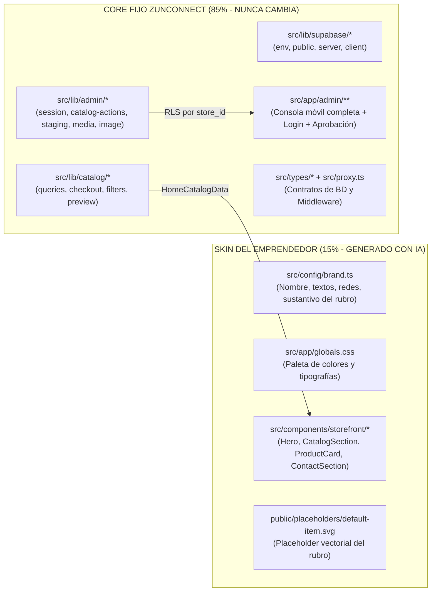

# Playbook ZunConnect: Fábrica de Tiendas con IA para Pequeños Emprendedores

> **Visión de Negocio:** **ZunConnect** ofrece tiendas en línea profesionales con catálogo autogestionable (`/admin`), optimizadas para móviles y conectadas a WhatsApp o pasarelas de pago, sobre una única infraestructura **Supabase Multi-Tenant Zero-Trust** y despliegues independientes en **Vercel**.
>
> **Meta operativa:** Lanzar un nuevo tenant (desde las fotos de WhatsApp/Instagram del emprendedor hasta producción con su propio panel `/admin`) en **menos de 30 minutos** asistido por IA.

---

## 1. El Secreto de la Velocidad: Arquitectura "85% Core Fijo / 15% Skin de Marca"

En lugar de programar cada tienda desde cero, toda tienda ZunConnect se divide en dos capas estrictamente separadas:



### Lo que se parametriza en `src/config/brand.ts` para no tocar el `/admin`:
En `floristeria-elangel`, algunos mensajes del panel decían `"ramo"` (`"Escribe el nombre del ramo"`). Al extraer el sustantivo del rubro a una constante (`ITEM_NOUN = "pastel" | "ramo" | "producto"`), **la carpeta `src/app/admin/` y `src/lib/admin/` se vuelve 100% agnóstica del negocio** y se copia sin editar una sola línea entre clientes.

---

## 2. Ficha de Onboarding del Cliente (`tenant-brief.json`)

Antes de abrir el editor con IA, recopila estos 8 datos del emprendedor (toma 5–10 minutos por WhatsApp):

```json
{
  "storeSlug": "dulce-delia",
  "storeName": "Donde Delia",
  "tagline": "Repostería artesanal · Cakes y eventos en La Habana",
  "itemNounSingular": "pastel",
  "itemNounPlural": "pasteles",
  "skuPrefix": "DEL-CAKE",
  "countryCode": "CU",
  "currency": "USD",
  "whatsappNumber": "5358383378",
  "ownerEmails": ["amauryst@gmail.com", "delia.ontivero88@gmail.com"],
  "checkoutConfig": {
    "saveOrders": false,
    "showDeliveryZone": false,
    "paymentMethods": ["WHATSAPP_COORDINATION"]
  },
  "categories": [
    { "name": "Cakes de Nata", "slug": "nata", "groupType": "OCCASION", "sortOrder": 1 },
    { "name": "Bodas", "slug": "bodas", "groupType": "OCCASION", "sortOrder": 2 },
    { "name": "Cumpleaños", "slug": "cumpleanos", "groupType": "OCCASION", "sortOrder": 3 },
    { "name": "Niños", "slug": "ninos", "groupType": "OCCASION", "sortOrder": 4 }
  ],
  "palette": {
    "background": "#FBF2EA",
    "surface": "#FFFCF8",
    "primary": "#B56576",
    "accent": "#C0925A",
    "text": "#4A3A32"
  }
}
```

---

## 3. Flujo Estándar de Creación de una Tienda con IA (5 Pasos)

### Paso 1: Preparar Fotos y Catálogo Semilla (5 min)
- El emprendedor envía entre 10 y 40 fotos de sus productos (por WhatsApp o descargadas de su Instagram/Facebook).
- **Truco heredado de Floristería El Ángel:** Nombrar los archivos con el precio o categoría (ej. `01-35 usd - cake nata chocolate.jpeg`) o pasar la carpeta de imágenes a la IA para que genere `seed/products.json` con `name`, `slug`, `short_description`, `description`, `price_cents`, `category_slugs`, `alt` e `image_file`.

### Paso 2: Alta del Tenant en Supabase (3 min)
- Pedir a la IA que genere el archivo `supabase/migrations/<timestamp>_init_tenant_<slug>.sql` a partir de `tenant-brief.json`.
- Ejecutar el SQL en el **Supabase SQL Editor**:
  - Crea la fila en `public.stores`.
  - Crea las filas en `public.categories` y `public.delivery_zones`.
  - Asigna `OWNER` en `public.store_members` a `amauryst@gmail.com` y al correo del emprendedor.

### Paso 3: Ensamblar el Repositorio (Core ZunConnect + Skin del Cliente) (10 min)
- **Caso A (El cliente ya tiene un sitio estático/Vite como `dulce-delia`):**
  La IA inyecta el Core ZunConnect (`src/lib/`, `src/app/admin/`, `src/types/`, `src/proxy.ts`, `next.config.ts`) y conecta la galería existente del sitio a `getHomeCatalogData()` (`v_catalog_products`).
- **Caso B (El cliente no tiene sitio web):**
  Clonar el repositorio plantilla (`zunconnect-store-template` derivado de `floristeria-elangel` / `dulce-delia`) y pedir a la IA que rediseñe únicamente los componentes de `src/components/storefront/` y `src/app/globals.css` según la paleta y rubro de `tenant-brief.json`.

### Paso 4: Migración Automática de Imágenes y Productos (3 min)
- Configurar `.env.local` con `NEXT_PUBLIC_STORE_SLUG=<slug>` y `SUPABASE_SERVICE_ROLE_KEY`.
- Ejecutar:
  ```bash
  npm run migrate:catalog            # Dry-run: verifica conteo, slugs y precios
  npm run migrate:catalog -- --apply # Convierte a WebP 1000px q82, sube al bucket y publica
  ```

### Paso 5: Despliegue en Vercel y Entrega al Cliente (5 min)
1. Subir el repositorio a GitHub (`AmauryST/<slug>`) y conectarlo a un nuevo proyecto en Vercel.
2. Configurar en Vercel únicamente las 3 variables públicas:
   - `NEXT_PUBLIC_SUPABASE_URL`
   - `NEXT_PUBLIC_SUPABASE_ANON_KEY`
   - `NEXT_PUBLIC_STORE_SLUG` = `<slug>`
3. En **Supabase Dashboard → Authentication → URL Configuration → Redirect URLs**, agregar:
   - `https://<dominio-del-cliente>/**`
4. Si el cliente entra con Gmail y el proyecto Google Cloud (`zun.store@gmail.com`) sigue en modo *Testing*, añadir el correo del cliente en *Google Cloud Console → OAuth consent screen → Test users* (o publicar la app OAuth en producción para olvidarse de este paso para siempre).

---

## 4. Prompts Maestros para Agentes de IA (Copiar y Pegar)

### Prompt 1: Convertir un Catálogo Estático Existente en Tenant ZunConnect (Caso `dulce-delia`)

```markdown
Actúa como Arquitecto Principal de ZunConnect. Vamos a convertir este repositorio de catálogo estático en un tenant productivo de ZunConnect conectado a nuestro proyecto compartido de Supabase, siguiendo exactamente la arquitectura y estándares de seguridad del proyecto hermano en `D:\projects\floristeria-elangel\el-angel-admin`.

Reglas innegociables:
1. Lee `CLAUDE.md` y `docs/01-plan-migracion-zunconnect.md` antes de escribir código.
2. Migra el proyecto a Next.js 16 (App Router) + TypeScript estricto + Tailwind CSS + `@supabase/ssr`.
3. Copia/adapta de `D:\projects\floristeria-elangel\el-angel-admin`:
   - `src/lib/supabase/*` (`env.ts`, `public.ts`, `server.ts`, `client.ts`)
   - `src/lib/catalog/*` (`queries.ts`, `checkout.ts`, `filters.ts`, `preview.ts`)
   - `src/lib/admin/*` y `src/app/admin/**` y `src/components/admin/*` (adaptando textos de "ramo" a "pastel")
   - `src/types/catalog.ts`, `src/types/admin.ts`, `src/proxy.ts` y `/api/admin/preview/route.ts`
4. Conserva el diseño visual, colores y secciones de la marca actual (`Navbar`, `Hero`, `HowItWorks`, `Gallery`, `Testimonials`, `ContactSection`, `Footer`), pero haz que `Gallery` consuma los productos desde `getHomeCatalogData()` (`public.v_catalog_products`) con ISR (`revalidate = 60`), imágenes por `media_by_slot.PRODUCT_PRIMARY` usando `SlotImage.tsx` y placeholder local `/placeholders/default-cake.svg`.
5. Crea la migración SQL idempotente en `supabase/migrations/` para dar de alta el store `dulce-delia`, sus categorías y sus miembros `OWNER`, y adapta `scripts/migrate-static-catalog.ts` para subir los 20 pasteles de `public/data/products.json` y sus fotos WebP a `product-images/{store_id}/{uuid}.webp`.
```

### Prompt 2: Crear una Nueva Tienda desde Cero a partir de Fotos de un Emprendedor

```markdown
Vamos a lanzar una nueva tienda ZunConnect para el emprendedor descrito en `tenant-brief.json` usando las fotos de la carpeta `source-images/`.
1. Analiza las fotos de `source-images/` y genera `seed/products.json` con nombres atractivos en español, descripciones breves orientadas a conversión, `alt` descriptivo, `price_cents` en centavos y asignación a las categorías de `tenant-brief.json`.
2. Genera la migración SQL idempotente en `supabase/migrations/` para registrar el tenant en `public.stores`, `public.categories`, `public.delivery_zones` y `public.store_members`.
3. Personaliza la paleta en `src/app/globals.css`, el placeholder vectorial en `public/placeholders/` y los componentes en `src/components/storefront/` para reflejar la identidad visual de `tenant-brief.json`, sin modificar ni una línea de `src/lib/` ni de `src/app/admin/` salvo las etiquetas en `src/config/brand.ts`.
4. Verifica con `npx tsc --noEmit` que no existan errores de tipos.
```

### Prompt 3: Auditoría Rápida de Seguridad Multi-Tenant

```markdown
Audita este repositorio contra las reglas de seguridad multi-tenant de ZunConnect (`CLAUDE.md`):
1. Verifica que ninguna clave secreta (`SUPABASE_SERVICE_ROLE_KEY`) se importe fuera de `scripts/` ni tenga prefijo `NEXT_PUBLIC_`.
2. Verifica que toda consulta en `src/lib/catalog/` y `src/lib/admin/` filtre explícitamente por `store_id` resuelto desde `NEXT_PUBLIC_STORE_SLUG`.
3. Verifica que todo Server Action en `src/lib/admin/` invoque `requireAdmin()` al inicio y use el cliente de sesión del miembro (`ctx.supabase`), jamás service role.
4. Verifica que no existan cadenas base64 ni `blur_data_url` y que todas las imágenes del catálogo provengan de `media_by_slot`.
```

---

## 5. Mejoras Recomendadas para Escalar ZunConnect (Próximos Pasos del Emprendimiento)

1. **Crear el repositorio base `zunconnect-store-template` en GitHub:**
   - Una vez completada la migración de `dulce-delia`, marcar ese repositorio limpio (ya en React puro sin el `build.py` legado de Python de El Ángel) como **GitHub Template Repository**. Así, cada nuevo cliente nace con 1 clic en *"Use this template"*.
2. **Publicar la pantalla de consentimiento de Google OAuth (`zun.store@gmail.com`):**
   - Pasar el proyecto de Google Cloud de modo *Testing* a *In Production* para que cualquier nuevo emprendedor con correo `@gmail.com` pueda iniciar sesión en su `/admin` al instante sin tener que agregarlo manualmente a la lista de 100 usuarios de prueba de Google Cloud.
3. **Endurecer `create_checkout_order` para futuros tenants que sí guarden pedidos (`save_orders = true`):**
   - Aunque las tiendas en Cuba (`floristeria-el-angel`, `dulce-delia`) usan `save_orders = false` (WhatsApp directo), antes de lanzar un tenant en otro país con `save_orders = true` conviene añadir una validación en la RPC `create_checkout_order` que rechace `jsonb_array_length(p_items) = 0`.
